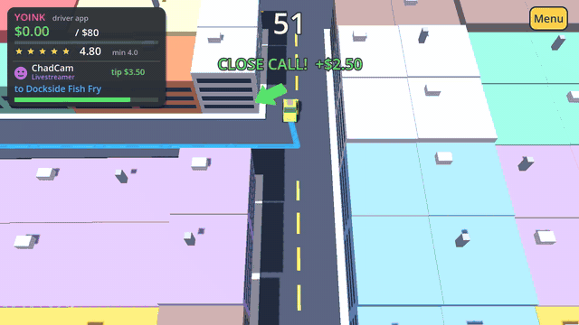

# Surge Pricing

**▶ [Play free in your browser](https://ahab94.github.io/surge-pricing/)** · [Downloads](https://github.com/ahab94/surge-pricing/releases/latest)



*Arcade taxi chaos meets the gig economy.* You drive for **Yoink**, a rideshare app that
pays by the minute and judges you by the star. Pick up passengers, follow the in-app
route, drive like a maniac for tips, and beat the shift clock. But your **driver rating
is your health bar**: every passenger leaves a review, and if your rating sinks below
the floor, the app deactivates you.

Passengers talk while you drive ("MY HIP!", "CHAT SAW THAT!"), and police chases,
ambulances and a VIP motorcade show up when you least need them.

Made with Godot 4.7, everything built in code: an angled 3D city over a 2D arcade
simulation. No art files, no licensed music. If you enjoy it, a ⭐ on the repo helps a lot.

## Install

- **Browser (phones too):** https://ahab94.github.io/surge-pricing/
- **macOS / Linux:** `curl -fsSL https://raw.githubusercontent.com/ahab94/surge-pricing/main/install.sh | bash`
- **Windows (PowerShell):** `irm https://raw.githubusercontent.com/ahab94/surge-pricing/main/install.ps1 | iex`
- Or grab a zip from [Releases](https://github.com/ahab94/surge-pricing/releases/latest).

## Controls

| | Keyboard | Touch |
|---|---|---|
| Drive | Arrows / WASD | Left thumb: floating stick (point where you want to go) |
| Drift (handbrake) | Space / Shift | DRIFT button |
| Brake / reverse | Down / S | BRAKE button |
| Retry / menu / next | R / Esc / Enter | Buttons |

Every passenger shouts in a speech bubble: Nana on a crash ("I'm calling your mother."),
the Livestreamer on a jump ("CHAT ARE YOU SEEING THIS?!"), the Hustle Bro on a splash
("Liquidity event!").

## How a shift works

- **Ride requests** glow at stops around the city. The colour shows how far they're going
  (green short, yellow medium, red long). Stop inside a circle to pick someone up.
- **The app** draws your route in blue and the big arrow points the way. With no one
  aboard, it points to the nearest request.
- **Drop off** by stopping in the blue ring before the fare timer runs out, or the
  passenger bails ("I'll walk.") and leaves one star.
- **The shift clock** counts down. Drop-offs add time: SPEEDY +12 s, Nice +8 s, Slow +4 s.
  Earn the shift's goal before it hits zero.
- **Stunts tip:** close calls with traffic, drifts, and big air off the yellow ramps. You
  can jump the canal if you're going flat out. Tips only pay out on a good review.
- **Mood → review → rating.** Each passenger has a mood that your driving moves up or
  down. At drop-off, mood becomes 1–5 stars and a review. Your rating is the average of
  your last 20 reviews.

### Passengers

| Type | Loves | Hates | Pays |
|---|---|---|---|
| Rider | getting there | crashes | normal |
| Livestreamer | crashes, jumps, near misses ("CONTENT!") | boring, slow driving | 2.5× stunt tips |
| Nana | a smooth, gentle ride | speed, bumps, stunts | 1.6× fare, never tips for stunts, $5 + a butterscotch for 5 stars |
| Hustle Bro | speed | waiting | 2× fare, tight timer |

### Special traffic

Every so often the app flashes an alert and something special hits the streets:

- **Police chase.** A getaway car and two cruisers tear around the ring road. Ram the
  getaway car for a **Citizen's Arrest (+$15)**. Bump a cruiser and you're fined.
- **Ambulance.** Sirens on, straight down the middle, and traffic pulls over. Block it
  and you're fined ("MOVE IT!"). Tail it through the gap for **Ambulance Chaser** tips.
- **Garbage truck.** Long, slow, stops to collect. Overtake it. Bumping it: "EWW!"
- **VIP motorcade.** Escort bikes and black SUVs with flags. Touch it and it's a
  **Diplomatic Incident (−$25)**. Livestreamers love that.

Close calls with any of them tip extra.

### The World Tour

Ten cities, one shift each. Every city adds one new thing:

| # | City | New | Flavor |
|---|---|---|---|
| 1 | Paris | The basics: pick up, follow the arrow, drop off | River bridges, a big roundabout with an arch, an iron lattice tower |
| 2 | New York | Traffic and close calls | A strict grid of yellow cabs, a huge park, a harbor statue |
| 3 | Rio | Livestreamers and ramps | Beach avenue, sugarloaf hills, a canal to fly over |
| 4 | Rome | Nana | Scooters, an ancient arena roundabout, a coin fountain |
| 5 | Dubai | Hustle Bros and the VIP motorcade | Supercars, desert, a super-tall spire, a palm island to jump |
| 6 | London | Driving on the left, and rain | Red double-deckers, a clock tower, an observation wheel |
| 7 | Tokyo | Surge zones and drifting | A scramble crossing, neon, cherry blossoms, a red lattice tower |
| 8 | Istanbul | Police chases | A strait split by two long bridges |
| 9 | Bangkok | Canals and tuk-tuk swarms, monsoon | Canals everywhere, a jagged tower |
| 10 | Singapore | The night shift: everything at once | Giant metal trees, a bay to jump, city lights |

Landmarks are generic shapes and every business is a parody.

Stars per city: ★ hit the goal, ★★ finish with a rating of 4.7+, ★★★ also beat the par time.

## Design notes

- **Cities are data.** Each city is a few lines in `tools/maps/make_cities.py` (roads,
  rivers, parks, landmarks, stops, traffic loops, look). The script checks every map (all
  stops reachable, traffic loops on clean road) and writes `scripts/cities.gd`.
- **3D look, 2D brain.** The rules run on a flat 2D map, which keeps them simple,
  deterministic and testable. `view3d.gd` builds the city in 3D from the same map and
  draws everything under a tilted camera. The bot, tests and replays don't know about it.
- **Arcade car, not a physics body.** Push along the nose, bleed off sideways speed
  ("grip"), and drop the grip for drifts. That gives tight control and exactly
  repeatable runs.
- **Deterministic.** Each shift has a seed, traffic drives fixed loops, and the same
  inputs give the same shift. The autopilot is the "every shift is winnable" gate and
  will drive the video clips.
- **The comedy is in the reviews.** Every passenger type has review lines per star
  level and bail lines. They are the game's punchlines, and they make good Shorts.

## Roadmap

- [x] v0.1: city, car, traffic, 4 passenger types, 7 shifts, app HUD, reviews, rating floor,
  touch controls, portrait layout, autopilot gate, tests, angled 3D view, special traffic,
  talking passengers, stunt and hunt bot modes for footage
- [ ] Your playtest: car feel (speed, grip, drift), zoom, difficulty
- [ ] Audio: engine hum, honks, splash, cash-register tip, review "ding", adaptive music
  (`tools/make_audio.py`, synthesized, so nothing to license)
- [ ] Shifts 8–10:
  - **Carpool Chaos**: pool rides, two passengers who hate each other.
  - **Night Owl**: headlights only; Party Animals who love drifts.
  - **Airport Run** (finale): rush hour, every passenger type, surge.
- [ ] More riders:
  - Food Courier: a soup bag that spills on hard turns.
  - Dog Walker: dogs love open windows and speed.
  - First Date: two riders; awkward if you crash.
- [ ] Rookie bot for the difficulty curve; per-shift tuning
- [ ] Endless "Surge Hour" mode with an online-style leaderboard of your best shifts
- [x] Pipeline: GitHub (public), web build on Pages, Windows/macOS/Linux
- [ ] 10+ Shorts (6 made, see docs/marketing/shorts.md)

## Development

```bash
godot --path .                    # play
bash checks/verify.sh             # tests + autopilot must complete every shift
godot --path . -- --level=2 --autopilot   # watch the bot drive shift 3
```

See `CLAUDE.md` for dev flags and the code layout.
